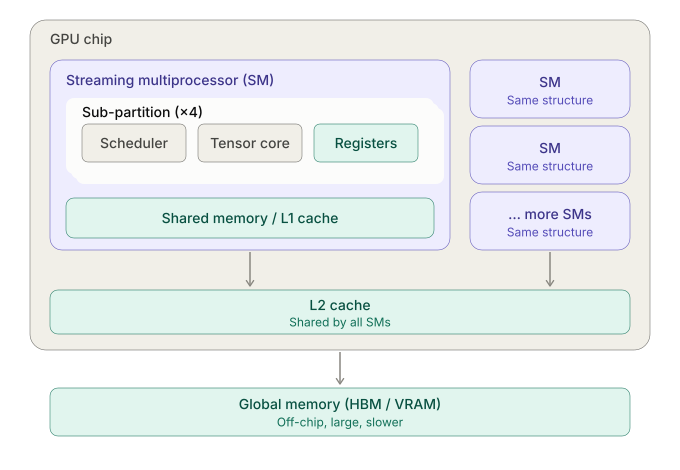

## GPU vs. CPU

CPUs are designed for **complex sequential execution** which is necessary for general purpose programming. On the other hand, GPUs are optimized for throughput and handling of **simple, massively parallel** workloads.

Workloads that require enormous volume of independent math operations are good fit for GPU, such as calculating the pixels of a high resolution frame and performing massive matrix multiplications in model training and inference.

## Internal Architecture

### Streaming Multiprocessor
The streaming multiprocessor (SM) is the basic building block of a GPU (roughly analogous to a CPU core); the number of SMs determines the compute capacity of a GPU instance (H100 has 132 total). Each SM has a few sub-partitions (e.g. 4) that can be scheduled to run different threads. A thread is the smallest unit of work that runs a simple program (kernel) with index pointing to its data. In fact, threads are so small that they are grouped into warps (32 threads executed together in lockstep), and sub-partition schedulers schedule warps instead of individual threads.

Within an SM, different cores exist to handle actual compute. Unlike CPU cores which are uniform and general purpose, GPUs use specialized cores that are optimized for specific operations:
* **CUDA cores (FP32)** - general floating-point math. 128 per SM.
* **INT32 and FP64 units** - integer math and double-precision float math. 64 per SM for each.
* **Tensor cores** - for calculating a small matrix multiplication (e.g. 4x4 blocks) in a single step, supporting different precisions depending on architectural generation. **Most important for AI workloads**. H100 has 4 per SM (1 per sub-partition).
* **Special Function Units (SFUs)** - accelerator for math functions such as sin, cos, ln, and square root, etc.

### Memory Hierarchy
Similar to CPU, besides the main memory (VRAM in GPU), GPU uses a few layers of caches (on-chip SRAM) to store data for compute. First of all, each SM has a register file that holds the live state for every resident thread. Typically, that's enough for each SM sub-partition to queue many wraps (e.g. 16 for H100) for scheduler to pick from at each step, and thus GPU can hide latency (threads waiting on memory) by switching to other warps that are ready without extra cost.

Each SM has a shared (L1) cache for all of its sub-partitions; a global (L2) cache is available for all SMs. The rest of the data is stored on VRAM (GDDR or HBM). In an H100, each L1 cache is 256 KB (same as the register file), and it is equipped with a 50 MB L2 cache and 80 GB of HBM3.

### Multi-instance GPU
Sometimes, one powerful GPU is too large for a single instance of smaller models, and instead of deploying them to older and cheaper hardware, newer high-performance GPUs (A100  and above) can be partitioned into smaller instances, each sharing a slice of the total compute and memory. This capability is called Multi-instance GPU (MIG), and it is a hardware-level configuration (cannot be dynamically changed) built into the chip. Each partition can be seen as a standalone GPU with complete isolation and run its own instance of the model.
