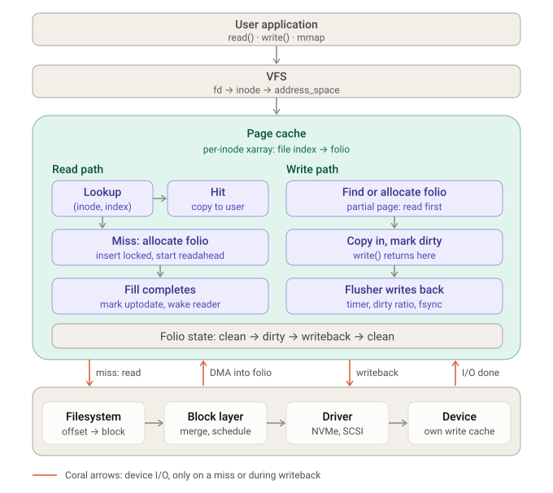

## File I/O Lifecycle

The page cache is a region of the system RAM (managed by the same virtual memory subsystem) that the kernel uses to hold page-sized (4 KB default, can be larger in modern kernels) file contents. The primary use of the page cache is to speed up file I/O by buffering data. Below is an overview of the typical disk I/O lifecycle that highlights how the page cache works:

The page cache is first keyed by `address_space` which is a unique identifier for an inode (mapped from file descriptor in application); the address space contains all the pages of this inode (file), and the page index can be derived from the file offset and page size. The content (folio) contains the actual file bytes in memory as well as some metadata like the page state flags.

All buffered I/O goes through the page cache; the kernel caches fairly aggressively using free RAM and gives back under memory pressure (evict from LRU list). There is also a (usually small) **`buff` (i.e. Buffers under `/proc/meminfo`) space that is a separate page cache memory used for block device address spaces**, i.e. file system metadata (super blocks, inode tables, etc). `Cached` is for actual file data.

## Other Applications

Besides standard file I/O, the page cache (as file-backed memory) is used for many other interesting ways to improve system performance and efficiency:
* **tmpfs** - file contents in a RAM-backed filesystem are all cached pages.
* **Memory-mapped files and I/O** - files (e.g. executable binaries and shared library) can be mapped directly to RAM using the page cache to share the content across different processes and/or skip copying the data to user space buffers (e.g. fast databases).
* **Network filesystems** - same mechanism but a different storage backend; the page cache caches remote data instead of file data.
