## Motivation

RAID is a storage volume abstraction built by combining multiple physical storage devices. A RAID device is seen by the operating system as a single logical volume that aggregates the capacity of its underlying devices. It can also boost performance by splitting the data and spreading them across devices so that I/O operations can be performed with the aggregate read/write rates, but a **striping-only (RAID 0) configuration means data on the entire array is permanently damaged if a single physical device fails**. To combat this, mission-critical systems with high durability requirements typically employ parity (RAID 6) or mirroring (RAID 10) to add additional fault tolerance.

Despite of having "inexpensive" in its name, RAID is not just used with older hard drives, the same technique is also used with modern SSDs and NVMe devices, although certain bottlenecks have changed with faster hardware. Nowadays, the main advantage of using RAID is high availability where data is recoverable and can be rebuilt without downtime when devices fail. However, **RAID is NOT backup**; it cannot protect against accidental deletion, replicated (logical) corruption, or theft/fire. RAID reduces the risk of independent device failure and nothing more.

## Implementation and Cost

Implementing RAID requires a controller component (the abstraction layer) that sits between the OS and the physical devices to handle RAID specific operations (e.g. mirroring, parity calculation). RAID controller can be a dedicated hardware chip with its own processor and memory to offload the work from the main CPU, but software based controllers are often just as fast nowadays on modern hardware which offer flexibility and are vendor-agnostic.

The main drawbacks of RAID are the extra capacity overhead (tradeoff for fault tolerance) and the complexity of maintaining it, especially with advanced configurations that try to prevent common production issues.

## Erasure Encoding

Classic RAID approach is extended to large storage systems for redundancy through erasure encoding. Under RAID 4/5, a single parity block is used to back up other blocks in the array; the data on the parity block is calculated by XORing bits on all nodes so that if any node is lost, its data can be derived by XORing the parity node with other surviving nodes. This offers single node failure tolerance with less overhead compared to mirroring. However, on production systems, especially with large hard drives (16-24 TBs), this is still considered risky due to the long rebuild times, and increased load during rebuild can lead to additional failures that ruin the array.

RAID 6 (double parity) or triple parity is typically encouraged for mission-critical storage systems which tolerates 2 or 3 node failures. The remarkable thing with erasure encoding is that it achieves the same tolerance guarantee with much less capacity overhead compared to mirroring at the cost of doing extra compute. As an example, double parity recovery involves solving 2 equations with 2 unknowns (representing the 2 missing data devices) which is much more costly than XORing. Here is a simple illustration of the math:

Each device is assigned a fixed known weight for each parity block (`1,1,1` and `1,2,3` above) used to calculate the parity blocks P and Q. Using double parity for an array of 10 nodes **only adds about 20% additional storage overhead whereas mirroring every node twice costs 200% more**!
